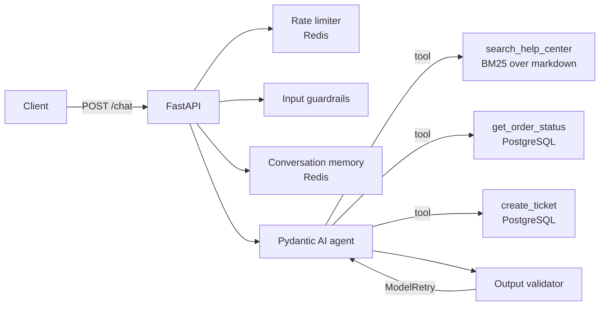

# AgentDesk

An AI customer-support agent behind an async FastAPI service. The agent answers policy questions from a help centre, looks up orders, and opens support tickets by **calling tools**. It always returns a **validated, structured reply**.

Built with **Pydantic AI**, **FastAPI**, **PostgreSQL**, **Redis** and **Docker**. It has strict type checking (mypy), linting (ruff), a pytest suite that needs no API key, and an evaluation script that scores the agent's tool choices against a real model.


## What it does

```text
POST /chat  {"session_id": "abc", "message": "I want to return my charger from ORD-1002, anna@example.com"}

{
  "session_id": "abc",
  "reply": {
    "answer": "I've opened a return ticket for your USB-C charger. You'll get a prepaid label by email.",
    "sources": ["returns.md#how-to-return"],
    "ticket_id": 1,
    "needs_human": false
  },
  "tools_used": ["search_help_center", "create_ticket"]
}
```

## Architecture



One request goes through these steps:
1. **Rate limit**: a Redis counter per client per minute (`INCR` + `EXPIRE`). Over the limit returns 429.
2. **Input guardrails**: rejects empty, very long, and prompt-injection-style messages before they reach the model (400).
3. **Memory**: loads the session's earlier messages from Redis, trimmed to the last N user turns. It only cuts at the start of a user turn, so a tool call is never separated from its result.
4. **Agent run**: the model decides which tools to call. The tools share one database session through dependency injection (`RunContext[Deps]`).
5. **Output guardrail**: an output validator rejects replies that cite a source that doesn't exist, or a ticket id that wasn't created in this run. The model gets a `ModelRetry` and has to fix its answer.
6. **Commit**: tickets created by tools are committed only if the whole run succeeds. If the model fails, they're rolled back.

## Design decisions

| Decision | Why |
|---|---|
| Structured output (`SupportReply`) instead of free text | The API contract stays stable, and sources and ticket ids can be checked in code. |
| `get_order_status` needs the order id **and** the matching email | The agent can't leak other customers' orders. "Not found" and "not yours" give the same answer. |
| BM25 keyword search for the help centre | The help centre is small. BM25 is fast, needs no embedding API, and is easy to test deterministically. |
| History in Redis with a TTL | Conversations are short-lived. Redis keeps the API stateless, so it can scale to several instances. |
| Tests use a scripted fake model (`FunctionModel`) | Tests are fast, free and deterministic. The real model is measured separately by the evals. |
| `create_app()` factory | Tests inject a fake Redis, a temporary database and a fake model without touching global state. |

## Run it

With Docker (API + PostgreSQL + Redis):

```bash
cp .env.example .env              # add your GOOGLE_API_KEY (free at aistudio.google.com)
docker compose up --build
open http://localhost:8000/docs   # interactive API docs
```

Without Docker (SQLite, but Redis must be running):

```bash
uv sync
uv run uvicorn agentdesk.main:app --reload
```

Demo data: customers `anna@example.com` (orders `ORD-1001`, `ORD-1002`) and `erik@example.com` (`ORD-1003`).

## Endpoints

| Method | Path | Purpose |
|---|---|---|
| `POST` | `/chat` | Send a message; returns the structured reply and the tools used |
| `DELETE` | `/chat/{session_id}` | Clear a conversation |
| `GET` | `/tickets?email=` | List tickets |
| `GET` | `/tickets/{id}` | Get one ticket |
| `GET` | `/health` | Checks the database and Redis |

## Quality checks

```bash
uv run pytest            # 27 tests, no API key needed
uv run mypy src tests    # strict mode
uv run ruff check .      # lint
uv run ruff format .     # format
```

CI runs all of these and builds the Docker image on every push.

## Evaluation

`evals/cases.json` has 15 cases covering policy questions, order lookups, ticket requests, missing information (the agent should ask instead of guessing), another customer's order, and off-topic questions. For each case the script checks that the agent:
- called the tools it should
- avoided the tools it shouldn't
- created a ticket only when one was needed

```bash
GOOGLE_API_KEY=... uv run python evals/run_evals.py
```

## Deploy

`render.yaml` is a Render Blueprint that sets up the web service, PostgreSQL and Redis. In Render, go to **New → Blueprint**, pick this repo, and set `GOOGLE_API_KEY`.

## Project layout

```text
src/agentdesk/
  agent.py        agent, tools, structured output, output validator
  api.py          FastAPI app factory and endpoints
  db.py           SQLAlchemy async models and demo data
  knowledge.py    markdown splitting and BM25 search
  memory.py       Redis conversation store and history trimming
  guardrails.py   input checks
  ratelimit.py    Redis rate limiter
  config.py       settings from environment variables
data/kb/          help-centre articles
tests/            pytest suite with a scripted fake model
evals/            real-model evaluation cases and runner
```
